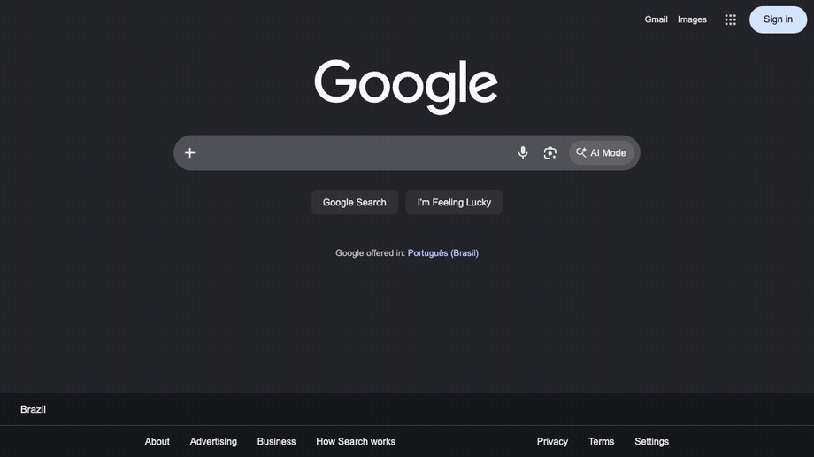

<p align="center">
     <br>
</p>
<p align="center">Browser automation for Python over raw CDP.<br>No WebDriver, no driver process, sync or async, and your Playwright scripts run on it with one import.</p>

<p align="center">
    <a href="https://github.com/IMXEren/pydoll/stargazers"></a>

    
    
    
    = 3.10">

</p>

<p align="center">
    <a href="https://imxeren.github.io/pydoll/">Documentation</a> &middot;
    <a href="#quick-start">Quick start</a> &middot;
    <a href="#already-on-playwright">Playwright</a> &middot;
    <a href="#features">Features</a> &middot;
    <a href="#support">Support</a>
</p>

> [!NOTE]
> **Pydoll 3 is here.** This release brings a synchronous API, a Playwright-compatible layer you enable with one import, new waiting methods and a faster core. It also comes with a few breaking changes, so read the [upgrade guide](https://imxeren.github.io/pydoll/docs/upgrading/) before bumping. We want to hear how it goes: share what works and what breaks in [an issue](https://github.com/IMXEren/pydoll/issues).

Pydoll drives the Chrome or Edge already on your machine over the DevTools Protocol. There is no WebDriver binary and no driver process between your code and the browser, so the usual automation markers (`navigator.webdriver`, `--enable-automation`, `Runtime.enable`) are never there to begin with. It clicks, types and scrolls like a person, applies coherent fingerprint profiles, handles Cloudflare Turnstile, and extracts typed data from the page. The API comes in a synchronous and an asynchronous form, and an existing Playwright script runs on it by changing one import.

### Why Pydoll?

- **Nothing to patch**: a direct CDP connection over WebSocket. No driver binary, no `navigator.webdriver` flag, no version-matching, and no stealth fork to keep up to date.
- **Fingerprint injection**: make the browser report a fully consistent identity with [`tab.apply_fingerprint()`](#fingerprint-injection): User-Agent, Client Hints, `navigator`, WebGL, canvas, screen, fonts, timezone and locale, all aligned. The overrides survive `toString` and prototype introspection and propagate into Web Workers, so lie-detection checks like CreepJS's don't flag them.
- **Humanized interactions**: [mouse movement](https://imxeren.github.io/pydoll/docs/guides/mouse/) along Bezier curves, realistic typing, and scroll physics. Often enough to pass behavioral challenges like Cloudflare Turnstile or reCAPTCHA v3, depending on your browser and IP reputation.
- **Sync or async, fully typed**: `from pydoll import Chrome` gives you the `asyncio` API, `from pydoll.sync import Chrome` the blocking one, with the same names, methods and defaults. Type-checked with `mypy`, full IDE autocompletion.
- **Playwright-compatible**: keep your Playwright script and [change one import](#already-on-playwright). Locators, `get_by_role`, auto-waiting, routes, dialogs and downloads keep their semantics, on Pydoll's connection.
- **Network control**: [intercept](https://imxeren.github.io/pydoll/docs/guides/request-interception/) requests to block ads and trackers, [monitor](https://imxeren.github.io/pydoll/docs/guides/network-monitoring/) traffic for API discovery, and make [authenticated HTTP requests](https://imxeren.github.io/pydoll/docs/guides/http-requests/) that inherit the browser session.
- **Shadow DOM and iframes**: full support for [shadow roots](https://imxeren.github.io/pydoll/docs/guides/dom-traversal/#shadow-dom) (including closed) and cross-origin iframes, with the same `find()`, `query()` and `click()` inside them.
- **Structured extraction**: define a [Pydantic](https://docs.pydantic.dev/) model, call `tab.extract_all()`, and get typed, validated objects back.

## Installation

```bash
pip install pydoll-python
```

Python 3.10 or newer, and Google Chrome or Microsoft Edge installed. No WebDriver, no browser download, no Node.

## Quick start

Open a page, find elements by how you'd describe them to a person, and interact with humanized timing:

```python
import asyncio

from pydoll import Chrome, Key

async def google_search(query: str):
    async with Chrome() as browser:
        tab = await browser.start()
        await browser.set_window_maximized()
        await tab.go_to('https://www.google.com')

        search_box = await tab.find(tag_name='textarea', name='q')
        await search_box.type_text(query, humanize=True)
        await tab.keyboard.press(Key.ENTER)

        first_result = await tab.find(tag_name='h3', text='IMXEren/pydoll', timeout=10)
        await first_result.click(humanize=True)
        await asyncio.sleep(5)
        print(f"Page loaded: {await tab.title()}")

asyncio.run(google_search('pydoll site:github.com'))
```

<p align="center">
  
</p>

The same script without `async`: import from `pydoll.sync` and drop the `await`s. The sync API is generated from the async one, so it never lags behind, and callbacks still work.

```python
from pydoll.sync import Chrome, Key

with Chrome() as browser:
    tab = browser.start()
    tab.go_to('https://www.google.com')

    tab.find(tag_name='textarea', name='q').type_text('pydoll site:github.com', humanize=True)
    tab.keyboard.press(Key.ENTER)

    tab.find(tag_name='h3', text='IMXEren/pydoll', timeout=10).click(humanize=True)
    print(f"Page loaded: {tab.title()}")
```

When the goal is data rather than interaction, define a model and let Pydoll extract it, typed and validated:

```python
import asyncio

from pydoll import Chrome, ExtractionModel, Field

class Quote(ExtractionModel):
    text: str = Field(selector='.text')
    author: str = Field(selector='.author')
    tags: list[str] = Field(selector='.tag')

async def main():
    async with Chrome() as browser:
        tab = await browser.start()
        await tab.go_to('https://quotes.toscrape.com')

        quotes = await tab.extract_all(Quote, scope='.quote', timeout=5)
        for quote in quotes:
            print(f'{quote.author}: {quote.text}')

asyncio.run(main())
```

[Getting started](https://imxeren.github.io/pydoll/docs/getting-started/) takes you from an empty folder to a working script; every example in the docs has a Sync and an Async tab.

## Already on Playwright?

Keep your script. Change one import and it runs on Pydoll's CDP connection, with Pydoll's stealth underneath.

```python
from pydoll.playwright.sync_api import sync_playwright  # was: from playwright.sync_api import sync_playwright

with sync_playwright() as p:
    browser = p.chromium.launch()
    page = browser.new_page()
    page.goto('https://quotes.toscrape.com/login')

    page.get_by_label('Username').fill('john')
    page.locator('#password').fill('SecretPass123')
    page.get_by_role('button', name='Login').click()
    page.wait_for_url('**/')
    print(page.get_by_role('link', name='Logout').is_visible())
    browser.close()
```

`pydoll.playwright.async_api` is the async flavor. The layer covers the browser automation surface: `Playwright`, `Browser`, `BrowserContext`, `Page`, `Frame`, `Locator`, `ElementHandle`, `Keyboard`, `Mouse`, routes, dialogs and downloads. `expect()` assertions, fixtures, tracing and the test runner are out of scope. When you need what Playwright can't do, `page.tab` is the Pydoll `Tab` underneath:

```python
with page.tab.expect_cloudflare_turnstile():
    page.goto('https://site-with-turnstile.com')
```

[Bring your Playwright script](https://imxeren.github.io/pydoll/docs/playwright/) is the walkthrough; [Playwright API](https://imxeren.github.io/pydoll/docs/guides/playwright-api/) is the full compatibility matrix.

## Staying undetected

### Fingerprint injection

Pydoll can also make the browser *report* a different identity. `tab.apply_fingerprint()` overrides the surface that fingerprinting scripts read (User-Agent and Client Hints, `navigator`, WebGL, canvas, screen, fonts, timezone and locale) and keeps those values consistent with each other.

Spoofing a fingerprint is less about changing the values than about not getting caught changing them. Modern anti-bot scripts inspect *how* a property was defined: a naive `Object.defineProperty` leaves a fake `toString`, an own-property where a prototype getter should be, or an override that a phantom `iframe` or a Web Worker can see straight through. Pydoll handles this: injected getters read as native under `toString` and prototype introspection, and the same identity is replayed inside dedicated, shared and service workers.

It also neutralizes the headless tells, chiefly the SwiftShader WebGL renderer that gives away a GPU-less browser, so `headless=True` is no longer an automatic giveaway. That is what lets a plain Google search run in headless mode. (Cloudflare Turnstile in headless is still under study.)

```python
import asyncio

from pydoll import Chrome

from examples.fingerprints import FINGERPRINTS

async def spoof_fingerprint():
    async with Chrome() as browser:
        tab = await browser.start()

        # Apply before navigating: the JS overrides register on every new document.
        await tab.apply_fingerprint(FINGERPRINTS['windows11_rtx3060_nyc'])

        await tab.go_to('https://abrahamjuliot.github.io/creepjs/')
        print('Fingerprint applied.')
        await asyncio.sleep(5)

asyncio.run(spoof_fingerprint())
```

In our testing it passed each of these fingerprint and bot-detection suites without being flagged:

| Test site | What it checks | Result |
| --- | --- | --- |
| [CreepJS](https://abrahamjuliot.github.io/creepjs/) | Lie detection, prototype / `toString` tampering, workers, fonts | No detection |
| [SannySoft](https://bot.sannysoft.com/) | Headless and bot signals | No detection |
| [BrowserScan](https://www.browserscan.net/bot-detection) | Bot-detection suite | No detection |
| [BrowserLeaks WebGL](https://browserleaks.com/webgl) | WebGL vendor / renderer / hash | No detection |
| [BrowserLeaks JavaScript](https://browserleaks.com/javascript) | `navigator` / JS environment | No detection |
| [BrowserLeaks Canvas](https://browserleaks.com/canvas) | Canvas fingerprint | No detection |
| [BrowserLeaks WebRTC](https://browserleaks.com/webrtc) | WebRTC IP leak | No detection |

A fingerprint is only as strong as its weakest layer. Anti-bot systems correlate signals across all of them. A browser that renders as macOS while its `Accept-Language` says Brazilian Portuguese, its timezone says Tokyo, and its IP geolocates to Germany is *more* suspicious than a browser you never touched. `apply_fingerprint()` keeps the layers it controls consistent, but you own the rest: the profile must match the real Chrome binary you drive (the network-layer TLS / HTTP2 fingerprint is authentic and cannot be spoofed) and the geography of your egress IP or proxy. The deep dive on [browser fingerprinting](https://imxeren.github.io/pydoll/docs/deep-dive/fingerprinting/) and the [Timezone and Locale Consistency](https://imxeren.github.io/pydoll/docs/stealth/evasion-techniques/) section explain why a locale that contradicts the IP gets you blocked.

> [!IMPORTANT]
> Pydoll does not generate or ship fingerprints. The profiles in [`examples/fingerprints.py`](examples/fingerprints.py) exist only as a reference for how coherent a profile has to be and the shape of the [`FingerprintConfig`](pydoll/protocol/fingerprint/types.py) you inject. Bring your own.

[Fingerprint Injection Docs](https://imxeren.github.io/pydoll/docs/stealth/fingerprint-injection/)

### Cloudflare Turnstile

Pydoll handles Cloudflare Turnstile the same way a person does: it finds the widget and places a realistic, humanized click on it. Whether Turnstile accepts the click depends on your browser fingerprint and IP reputation, which is why the two sections above come first.

```python
import asyncio

from pydoll import Chrome

async def solve_turnstile():
    async with Chrome() as browser:
        tab = await browser.start()

        # Waits for the Turnstile widget, performs a realistic click,
        # and continues once it settles.
        async with tab.expect_cloudflare_turnstile():
            await tab.go_to('https://site-with-turnstile.com')

        print('Turnstile handled, continuing...')

asyncio.run(solve_turnstile())
```

<p align="center">
  
</p>
<p align="center"><sub>Pydoll getting past a Cloudflare Turnstile challenge with a realistic, humanized click.</sub></p>

> [!NOTE]
> This isn't a bypass. Pydoll performs the same click a real user would; whether it passes depends on your environment (browser fingerprint and IP reputation). See the [Turnstile docs](https://imxeren.github.io/pydoll/docs/stealth/captcha-bypass/) for details.

## Features

The sections above cover the flows most people start with. The rest is below: click any item to expand a short explanation, a runnable example, and a link to its full guide.

<details>
<summary><b>Structured Data Extraction (Pydantic)</b></summary>
<br>

Define what you want with a [Pydantic](https://docs.pydantic.dev/) model and Pydoll maps the DOM straight into typed, validated Python objects, no manual element-by-element querying. Models support CSS/XPath auto-detection, HTML attribute targeting, custom transforms, and nested models.

```python
import asyncio

from pydoll import Chrome, ExtractionModel, Field

class Quote(ExtractionModel):
    text: str = Field(selector='.text', description='The quote text')
    author: str = Field(selector='.author', description='Who said it')
    tags: list[str] = Field(selector='.tag', description='Tags')

async def extract_quotes():
    async with Chrome() as browser:
        tab = await browser.start()
        await tab.go_to('https://quotes.toscrape.com')

        quotes = await tab.extract_all(Quote, scope='.quote', timeout=5)

        for q in quotes:
            print(f'{q.author}: {q.text}')  # fully typed, IDE autocomplete works
            print(q.model_dump_json())       # pydantic serialization built-in

asyncio.run(extract_quotes())
```
</details>

<details>
<summary><b>Humanized Mouse Movement</b></summary>
<br>

Mouse operations can produce human-like cursor movement when you pass `humanize=True`:

- Bezier curve paths with asymmetric control points
- Fitts's Law timing, so duration scales with distance
- Minimum-jerk velocity, a bell-shaped speed profile
- Physiological tremor, Gaussian noise scaled with velocity
- Overshoot correction, about 70% of fast movements overshoot and correct back

```python
await tab.mouse.move(500, 300, humanize=True)
await tab.mouse.click(500, 300, humanize=True)
await tab.mouse.drag(100, 200, 500, 400, humanize=True)

button = await tab.find(id='submit')
await button.click(humanize=True)

# Default is fast, non-humanized movement
await tab.mouse.click(500, 300)
```

[Mouse Control Docs](https://imxeren.github.io/pydoll/docs/guides/mouse/)
</details>

<details>
<summary><b>Shadow DOM Support</b></summary>
<br>

Full Shadow DOM support, including closed shadow roots. Because Pydoll operates at the CDP level (below JavaScript), the `closed` mode restriction doesn't apply.

```python
shadow = await element.get_shadow_root()
button = await shadow.query('.internal-btn')
await button.click()

# Discover all shadow roots on the page
shadow_roots = await tab.find_shadow_roots()
for sr in shadow_roots:
    checkbox = await sr.query('input[type="checkbox"]', raise_exc=False)
    if checkbox:
        await checkbox.click()
```

Highlights:
- Closed shadow roots work without workarounds
- `find_shadow_roots()` discovers every shadow root on the page
- `timeout` parameter for polling until shadow roots appear
- `deep=True` traverses cross-origin iframes (OOPIFs)
- Standard `find()`, `query()`, `click()` API inside shadow roots

[Shadow DOM Docs](https://imxeren.github.io/pydoll/docs/guides/dom-traversal/#shadow-dom)
</details>

<details>
<summary><b>HAR Network Recording</b></summary>
<br>

Record network activity during a browser session and export it as HAR 1.2. Every entry keeps its request, response, headers, body and timings, ready for DevTools or any HAR viewer.

```python
from pydoll import Chrome

async with Chrome() as browser:
    tab = await browser.start()

    async with tab.request.record() as capture:
        await tab.go_to('https://example.com')

    capture.save('flow.har')
    print(f'Captured {len(capture.entries)} requests')
```

[HAR Recording Docs](https://imxeren.github.io/pydoll/docs/guides/network-recording/)
</details>

<details>
<summary><b>Page Bundles</b></summary>
<br>

Save the current page and all its assets (CSS, JS, images, fonts) as a `.zip` bundle for offline viewing. Optionally inline everything into a single HTML file.

```python
await tab.save_bundle('page.zip')
await tab.save_bundle('page-inline.zip', inline_assets=True)
```

[Screenshots, PDFs & Bundles Docs](https://imxeren.github.io/pydoll/docs/guides/screenshots-and-pdfs/)
</details>

<details>
<summary><b>Hybrid Automation (UI + API)</b></summary>
<br>

Use UI automation to pass login flows (CAPTCHAs, JS challenges), then switch to `tab.request` for fast API calls that inherit the full browser session: cookies, headers, and all.

```python
# Log in via UI
await tab.go_to('https://my-site.com/login')
await (await tab.find(id='username')).type_text('user')
await (await tab.find(id='password')).type_text('pass123')
await (await tab.find(id='login-btn')).click()

# Make authenticated API calls using the browser session
response = await tab.request.get('https://my-site.com/api/user/profile')
user_data = response.json()
```
[Hybrid Automation Docs](https://imxeren.github.io/pydoll/docs/guides/http-requests/)
</details>

<details>
<summary><b>Network Interception and Monitoring</b></summary>
<br>

Monitor traffic for API discovery or intercept requests to block ads, trackers, and unnecessary resources.

```python
import asyncio

from pydoll import Chrome, FetchEvent
from pydoll.protocol.fetch.events import RequestPausedEvent
from pydoll.protocol.network.types import ErrorReason

async def block_images():
    async with Chrome() as browser:
        tab = await browser.start()

        async def block_resource(event: RequestPausedEvent):
            request_id = event['params']['requestId']
            resource_type = event['params']['resourceType']

            if resource_type in ['Image', 'Stylesheet']:
                await tab.fail_request(request_id, ErrorReason.BLOCKED_BY_CLIENT)
            else:
                await tab.continue_request(request_id)

        await tab.enable_fetch_events()
        await tab.on(FetchEvent.REQUEST_PAUSED, block_resource)

        await tab.go_to('https://example.com')
        await asyncio.sleep(3)
        await tab.disable_fetch_events()

asyncio.run(block_images())
```
[Network Monitoring](https://imxeren.github.io/pydoll/docs/guides/network-monitoring/) | [Request Interception](https://imxeren.github.io/pydoll/docs/guides/request-interception/)
</details>

<details>
<summary><b>Browser Fingerprint Control</b></summary>
<br>

Granular control over [browser preferences](https://imxeren.github.io/pydoll/docs/guides/browser-preferences/): hundreds of internal Chrome settings for building consistent fingerprints.

```python
from pydoll import ChromiumOptions

options = ChromiumOptions()

options.browser_preferences = {
    'profile': {
        'default_content_setting_values': {
            'notifications': 2,
            'geolocation': 2,
        },
        'password_manager_enabled': False
    },
    'intl': {
        'accept_languages': 'en-US,en',
    },
    'browser': {
        'check_default_browser': False,
    }
}
```
[Browser Preferences Guide](https://imxeren.github.io/pydoll/docs/guides/browser-preferences/)
</details>

<details>
<summary><b>Concurrency, Contexts and Remote Connections</b></summary>
<br>

Manage [multiple tabs](https://imxeren.github.io/pydoll/docs/guides/tabs/) and [browser contexts](https://imxeren.github.io/pydoll/docs/guides/browser-contexts/) (isolated sessions) concurrently. Connect to browsers running in Docker or remote servers.

```python
import asyncio

from pydoll import Chrome

async def scrape_page(url, tab):
    await tab.go_to(url)
    return await tab.title()

async def concurrent_scraping():
    async with Chrome() as browser:
        tab_google = await browser.start()
        tab_ddg = await browser.new_tab()

        results = await asyncio.gather(
            scrape_page('https://google.com/', tab_google),
            scrape_page('https://duckduckgo.com/', tab_ddg)
        )
        print(results)
```
[Multi-Tab Management](https://imxeren.github.io/pydoll/docs/guides/tabs/) | [Remote Connections](https://imxeren.github.io/pydoll/docs/guides/remote-connections/)
</details>

<details>
<summary><b>Retry Decorator</b></summary>
<br>

The `@retry` decorator supports custom recovery logic between attempts (e.g., refreshing the page, rotating proxies) and exponential backoff.

```python
from pydoll.decorators import retry
from pydoll.exceptions import ElementNotFound, NetworkError

@retry(
    max_retries=3,
    exceptions=[ElementNotFound, NetworkError],
    on_retry=my_recovery_function,
    exponential_backoff=True
)
async def scrape_product(self, url: str):
    # scraping logic
    ...
```
[Retry Decorator Docs](https://imxeren.github.io/pydoll/docs/guides/retrying/)
</details>

---

## Contributing

Contributions are welcome, whether that is a bug report, a docs fix, or a new feature. If you are not sure where to start, open an issue and we can figure it out together. [CONTRIBUTING.md](CONTRIBUTING.md) has the dev setup, how to run the tests, and the code style and commit conventions. With one maintainer right now, a clear reproduction or a focused pull request genuinely helps.

## Support

A few ways to help Pydoll:

- Star the repo so more people find it (yes, the joke at the top still stands).
- [Report a bug](https://github.com/IMXEren/pydoll/issues) or a rough edge you hit. A good issue is worth a lot.
- Improve a docs page, or answer someone else's question in the issues.


Any of these keeps the project moving.

## License

Pydoll is released under the [MIT License](LICENSE). Use it in personal or commercial projects, as long as you keep the copyright notice.
